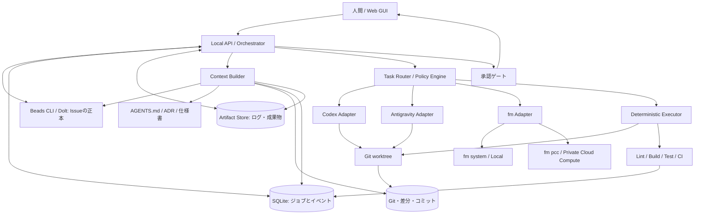
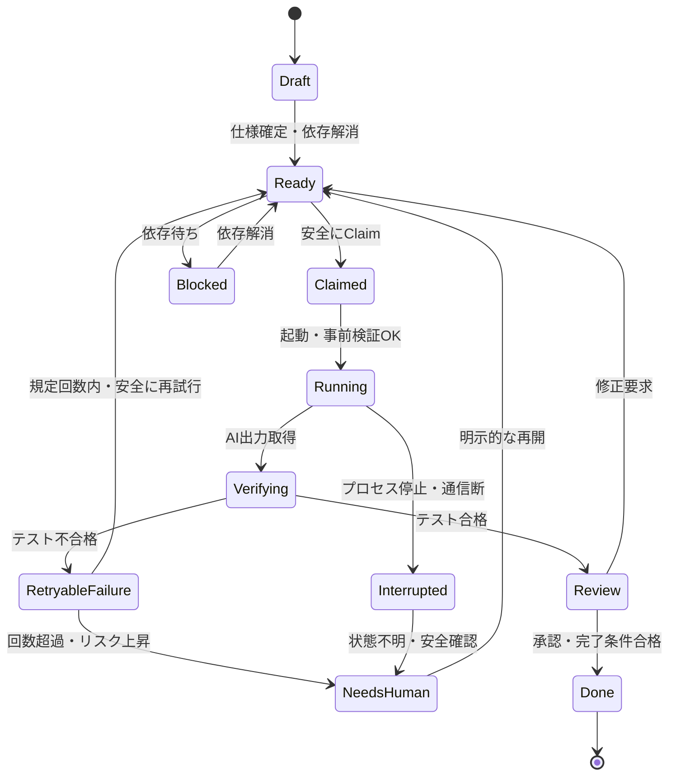

# Mac mini AI開発マシン 実装計画書

> **版**: v1.0（初期実装計画）  
> **作成日**: 2026-11-12  
> **対象機**: Mac mini M4 Pro / ユニファイドメモリ 48GB  
> **対象業務**: Webサービス開発・保守・デプロイ、システム開発、ゲーム開発  
> **方針**: BeadsをIssueの正本とし、IssueからAI作業用コンテキストを復元できるローカル・マルチエージェント開発基盤を構築する。  
> **文書の位置づけ**: 実装開始に利用する設計・工程・受け入れ条件をまとめた計画。CLIの利用可能性、認証、モデル枠、実機のOS条件は導入時に検証する。

---

## 0. エグゼクティブサマリー

構築対象は、**「Beads中心のIssue駆動AI開発システム」**とする。人間はWeb GUIから依頼・確認・コメント・承認を行い、Codexは要件定義・タスク分解・最終判定、Antigravity CLIは複雑な実装・テスト設計・コードレビュー、Apple `fm`は単純な作業をローカル、中程度の作業をPrivate Cloud Compute（PCC）で処理する。コンパイラ、テストランナー、Git、ビルド、デプロイは**AIではなく確定的な実行プログラム**が担当する。

核となる要件は、**初めて起動したAIでも、Issue IDを起点に過去の意思決定・現在の状態・関連資料・失敗履歴を取得して作業を再開できること**である。

採用する基本原則：

1. **Issueが入口、BeadsがIssue情報の正本**。大容量のログや生成物を無理にIssue本文に貼り付けない。
2. **すべての根拠へ到達できることと、毎回すべてをAIに送ることを分離**する。
3. **AIは提案と編集、システムは実行と検証、人間は重大な承認**を担当する。
4. **記憶と実行の分離**。Issueは作業の意味・意思決定を保持し、実行履歴・プロセス・アーティファクトは別の永続ストアを保持する。
5. **途中停止を前提とした設計**。クラッシュ・利用枠超過・通信断・認証切れから安全に再開できる。
6. **段階導入**。Beads単体 → Context Builder → 1エージェント実行 → 複数AIルーティング → GUI → 保守／デプロイの順に拡張する。

### MVPの定義

MVPは「Issue生成 → 要件の確認・承認 → AntigravityによるGit worktreeでの実装 → テスト実行 → Codexによる結果レビュー → GUIから確認 → 履歴がIssueから参照可能」までを扱う。`fm Local/PCC`は次段階で追加する。**本番自動デプロイ、無制限の自己修正、GUIからの任意コマンド実行はMVPに含めない。**

---

## 1. 前提・非機能要件・対象外

### 1.1 前提

- Mac miniは個人所有で、ローカル常駐サービスとして稼働する。
- 初期は利用者1人、同時作業は原則1 Issue、拡張後は2〜3 Issue程度の並行実行を想定する。これは設計上の初期上限であり性能保証ではない。
- AIのCLIは本人のアカウント認証と各社利用規約・利用枠に依存する。CLI利用枠とAPI課金を同一視しない。
- Apple `fm`は **macOS 27以降**が前提。Apple Intelligence対応、モデル準備状態、PCCの利用可否を実機で検証する。
- 開発対象リポジトリは原則Git管理されている。
- GUIは初期は`127.0.0.1`のみで公開。外部からの接続が必要ならTailscaleなどの認証済みネットワークを使用する。

### 1.2 非機能要件（初期目標）

| 区分 | 目標 |
|---|---|
| 情報の再現性 | 同一Issueのコンテキストに、生成日時・入力参照・版・内容ハッシュを記録 |
| 操作履歴 | Issueの重要操作、AI実行、承認、検証結果を追跡できる |
| 安全性 | 破壊的操作・本番反映は事前承認なしに実行不可 |
| 再開性 | プロセス異常終了後、孤児ジョブを検知し、人間が安全に再実行できる |
| データ完全性 | ログや成果物の参照切れ・欠損を定期検出 |
| 可観測性 | GUIでIssue、担当AI、試行回数、現在の工程、失敗理由を確認可能 |
| 保守性 | CLIアダプタ交換だけで、後継モデルや別AIへ移行可能 |
| 秘密保護 | 認証情報と本番秘密情報はIssue本文やLLMコンテキストへ注入しない |

### 1.3 初期対象外

- AIによる無制限の自律タスク生成・無限ループ
- ChatGPT Webの会話をそのまま常駐プロセスに変換する機能
- 本番サービスのDB削除・外部課金・公開デプロイの完全無人承認
- 動画、音楽、画像の完成物をLLMだけで強制作成するワークフロー
- 初期からのベクトルDB、Kubernetes、Redis、分散ジョブキュー
- Beads独自フォークの継続メンテナンス

---

## 2. 論理アーキテクチャ



> MermaidはMarkdown対応ビューアで図として表示可能。上図の矢印はデータ・制御の概念的経路を表し、全コンポーネントが相互に任意コマンド実行できるという意味ではない。

### 2.1 コンポーネント責任

| コンポーネント | 責任 | 情報の正本 |
|---|---|---|
| Beads | Issue、親子・依存関係、優先度、担当、コメント、クローズ | Beads/Dolt |
| Orchestrator | スケジューリング、状態遷移、承認ゲート、実行再試行 | SQLite（実行情報のみ） |
| Context Builder | Issue起点で情報を取得・要約・整形する読み取り層 | 元データに従う |
| Task Router | 役割・難易度・安全性・利用枠による担当決定 | ポリシー設定＋判断イベント |
| Codex Adapter | 非対話の設計・分解・検証・報告 | 実行結果はRecorder |
| Antigravity Adapter | 複雑な実装・修正・レビュー | 実行結果はRecorder |
| fm Adapter | `system`/`pcc`切り替えで定型作業と中程度の処理 | 実行結果はRecorder |
| Executor | Git、テスト、ビルド、限定されたデプロイ処理 | ログ・結果はRecorder |
| Execution Recorder | 実行プロセス、コマンド、出力、試行、使用モデル、検証 | SQLite＋Artifact Store |
| GUI | 閲覧、Issue作成、コメント、変更・承認・中断 | APIを介して正本へ書込 |

### 2.2 正本の境界（必須）

- **Issueの状態**：Beadsのみを正本にする。SQLiteにIssueタイトル・本文・進捗を二重管理しない（画面用キャッシュは再生成可能とする）。
- **実行の状態**：SQLiteのみを正本にする。`run_id`・PID・開始終了時刻・リトライ回数・leaseなど。
- **ソースコード**：Gitリポジトリ。Issue本文にコード全文をコピーしない。
- **大型ログ**：ファイル保存＋ハッシュ＋相対参照。Issueには要点と`run_id`を記録。
- **仕様・決定**：Issueの決定イベントと、プロジェクト共通ADR/AGENTS.mdに分離して保存する。正式な仕様変更の版を管理する。
- **秘密情報**：Keychain、各CLIの認証管理、デプロイ基盤のSecrets等。Issueやコンテキストには載せない。

---

## 3. 推奨技術スタック

| 層 | 推奨 | 理由・条件 |
|---|---|---|
| OS | macOS 27以降 | `fm`導入条件。実機でまず`sw_vers`確認 |
| Issue | Beads CLI + Dolt | AI向けIssue、依存関係、引継ぎに適合 |
| 統合バックエンド | Python 3.12+ + FastAPI | CLI起動、非同期I/O、GUI APIの実装が容易 |
| 実行管理DB | SQLite（WAL） | 初期の単一ホスト運用に十分 |
| バリデーション | Pydantic / JSON Schema | AI応答を構造化して検証 |
| GUI | React + TypeScript + Vite | Kanban・Issue・イベント閲覧を段階構築 |
| リアルタイム表示 | Server-Sent Events（SSE） | 実行中ログと状態通知の一方向配信に十分 |
| プロセス常駐 | launchd（LaunchAgent/必要時Daemon） | macOS標準。GUIログインの要否を個別に判断 |
| 作業分離 | Git worktree | 並列Issueの編集衝突防止 |
| テスト | pytest、Vitest等、対象プロジェクト固有のコマンド | 実行そのものにAIを介在させない |
| 検索 | Beads検索・SQLite FTS5・ファイル索引 | 初期にベクトルDBを導入しない |
| LAN外からの閲覧 | Tailscale等 | 公開ポート不要の接続を優先 |

### 3.1 構成選択の代替案

- **Beads Embedded**：最初の単一ライター検証に使用。AIが直接`bd`で競合書込みしないよう、Orchestratorを唯一の書込み窓口にする。
- **Beads Dolt Server**：複数プロセスが頻繁に同時書込みする段階で移行。移行手順・バックアップ・スキーマは対象バージョンで検証。
- **既存Beads GUI**：検証段階では使用可。ただし「ユーザーコメント→仕様変更→再計画→承認」等の独自ワークフローは専用UIで実装する方針。
- **将来のローカルモデル**：MLX/llama.cpp等のアダプタを追加可能にするが初期要件外。

---

## 4. リポジトリ・ディレクトリ設計

```text
~/AIWorkspace/
├── control-plane/                  # このシステム自身のGitリポジトリ
│   ├── apps/
│   │   ├── api/                     # FastAPI / API / Policy
│   │   └── web/                     # React GUI
│   ├── packages/
│   │   ├── orchestrator/            # スケジューラ・実行状態
│   │   ├── beads_adapter/           # bd呼び出し境界
│   │   ├── context_builder/         # コンテキスト組立
│   │   ├── agent_adapters/          # codex / agy / fm
│   │   ├── execution_recorder/      # ログ・イベント・成果物
│   │   └── policy_engine/           # 権限・承認・ルーティング
│   ├── config/
│   │   ├── projects.yaml            # 登録済みリポジトリ許可リスト
│   │   ├── routing.yaml             # モデル割当とフォールバック
│   │   └── policy.yaml              # 承認・実行制限
│   ├── schemas/                     # JSON Schema
│   ├── templates/                   # AGENTS / prompts / report
│   ├── docs/                        # ADR / 運用手順
│   └── tests/                       # unit / integration / e2e
├── projects/
│   ├── example-web/                 # 実際の開発リポジトリ
│   │   ├── .beads/                  # Beadsのプロジェクト単位DB
│   │   ├── AGENTS.md                # プロジェクト方針
│   │   └── ...
│   └── example-game/
├── worktrees/                       # Issueごとの作業用worktree
│   └── example-web/<issue-id>/
└── state/                           # 実行状態 / Gitに入れない
    ├── orchestrator.sqlite3
    ├── artifacts/<run-id>/          # stdout / stderr / reports
    ├── contexts/<issue-id>/         # 生成したContextのスナップショット
    └── backups/                     # 一時バックアップ保存先
```

- `projects.yaml`で、エージェントがアクセスできるリポジトリの**絶対パス許可リスト**を持つ。
- `~/AIWorkspace/state/`と各CLI認証領域はGit管理しない。
- `run_id`と`issue_id`は別概念。1 Issueに複数Runが紐づく。
- 複数リポジトリ間のIssue ID衝突を避けるため、APIの内部キーは`project_id + issue_id`とする。

---

## 5. Issue・履歴・決定のデータ設計

### 5.1 Issueの必須項目

| 項目 | 説明 | 保存先 |
|---|---|---|
| issue_id | Beads発行ID（例：`bd-a1b2`） | Beads |
| project_id | ローカルプロジェクト識別子 | Project Registry |
| title / description | 要件と背景 | Beads |
| type / priority | epic, feature, task, bug等 / 優先度 | Beads |
| status / assignee | Beadsの標準状態・担当 | Beads |
| parent / dependencies | 親子関係とブロッカー | Beads |
| acceptance_criteria | 機械判定できる粒度の受け入れ条件 | Issue説明の構造化節（または関連仕様） |
| decision_refs | 確定した判断への参照 | Issueコメント/Decision記録 |
| artifact_refs | Git commit、ログ、テストレポート | Issueコメント＋Artifact Registry |
| latest_handoff | 現状・未解決・次の操作 | Context Snapshot（原本は履歴） |
| risk_class | read_only / workspace_write / staging / production | Policy Engineのメタデータ |

Beads標準スキーマを無理に拡張せず、追加メタデータは自前DBの`issue_attributes(project_id, issue_id, ...)`で管理可能とする。ただしIssueの本文や状態を二重コピーして正本にしない。**カスタム属性の正本の所在を項目ごとに定める**。

### 5.2 コメントを「意味のあるイベント」に分類

| イベント種別 | 用途 | 後続動作 |
|---|---|---|
| `comment` | 参考・相談 | 履歴追加のみ |
| `decision_proposed` | AIによる変更提案 | GUIで人間判断待ち |
| `decision_approved` | 人間の確定方針 | 必読コンテキスト更新 |
| `requirement_changed` | 仕様変更 | Codexで影響分析・必要ならIssue再分解 |
| `run_started` / `run_finished` | 実行追跡 | 実行DB更新・Issueへ要約追記 |
| `test_passed` / `test_failed` | 検証結果 | レビューまたは修正へ |
| `approval_requested` / `approved` / `rejected` | 重要操作の承認 | 実行ゲート開放/停止 |
| `human_needed` | 音楽・画像・動画等の外部制作 | Issueを人間待ちにする |
| `handoff_written` | 次担当AI向け引き継ぎ | Context Builderへ反映 |

**すべてのコメントを同格の指示として扱わない。** 通常コメント中の「こうした方がいいかも」は正式な仕様変更ではない。正式決定は投稿者・権限・承認・時刻を記録する。

### 5.3 作業イベントの例

```json
{
  "event_id": "evt_01",
  "project_id": "example-web",
  "issue_id": "bd-a1b2",
  "run_id": "run_20261112_0001",
  "actor": "antigravity",
  "event_type": "test_failed",
  "occurred_at": "2026-11-12T13:15:00+09:00",
  "payload": {
    "test_id": "weekly-reset.test.ts",
    "reason_code": "timezone_mismatch",
    "commit": "a1b2c3d",
    "artifact_ref": "artifact://run_20261112_0001/test-report.json"
  }
}
```

- イベントは原則**追記型**とし、訂正は別イベントで行う。
- `schema_version`を各構造化イベントに付与し、将来の形式変更を可能にする（上記は説明簡略化のため省略）。
- 実行DBとBeadsの間に分散トランザクションは存在しない。重要イベントは**DBに記録→未反映アウトボックス→Beadsに反映→反映済みマーク**の順に処理し、再送時はイベントIDで冪等化する。
- コード変更はGit commit / diffへの参照を残す。Issueに全文を貼り付けない。

### 5.4 Issue完了条件

`bd close`を直接AIに許可しない。Orchestratorが以下を確認してから閉じる。

1. 受け入れ条件が満たされた。
2. 必須のLint/Build/Testが成功した。
3. 変更差分とコミットの参照が存在する。
4. Codexレビュー結果が`approved`（または人間が明示的に例外承認）。
5. 必要な人間承認が完了している。
6. 完了報告と引き継ぎ要約が保存されている。

---

## 6. Context Builder：Issueを入口とするRAG設計

### 6.1 コンセプト

独自インターフェース例：

```bash
aiops issue context example-web bd-a1b2 --mode standard --format markdown
aiops issue context example-web bd-a1b2 --mode full --format markdown
aiops issue context example-web bd-a1b2 --mode debug --format json
```

**`aiops`はこれから実装する仮称CLIであり、Beads標準コマンドではない。**

### 6.2 コンテキスト生成順序

1. 対象IssueをBeadsから取得する（`bd show <id> --json`）。
2. 親Issue・直接の依存Issue・関連Issueを取得する。検索深度を制限し循環参照を検出する。
3. プロジェクトルール（`AGENTS.md`、採用済みADR、共通仕様）を取得する。
4. Issueの**現在有効な要件**と承認済み決定を時系列ではなく優先順位付きで整理する。
5. 最新の成功/失敗Run、未解決問題、次の作業を取得する。
6. 関連するGit差分・テスト結果・成果物のメタデータを取得する。
7. タスクとモデルに応じて必要な情報を選別し、トークン予算内へ圧縮する。
8. **各節に出典ID**（Issue、コメント、ADR、commit、run、artifact）を残す。
9. 生成物をスナップショットとして保存し、後から「その時AIが何を見たか」を再現できるようにする。

### 6.3 情報の優先順位

1. 安全ポリシー・権限・データ分類（システムが強制する）
2. 人間が承認した最新の仕様・意思決定
3. 現在のIssueの受け入れ条件
4. 現行プロジェクトの設計原則・ADR
5. 関連Issueの参照情報
6. 作業履歴・AIの仮説・失敗ログ

**AIの過去のコメントと人間の確定指示が矛盾した場合は人間の確定指示を優先**する。ただし、変更後の影響範囲は再評価する。

### 6.4 取得モード

| mode | 内容 | 利用例 |
|---|---|---|
| `standard` | 要件、決定、現在状態、次の行動、根拠リンク | 通常実装 |
| `debug` | 再現手順、失敗ログ、最近の変更、試した対処 | 不具合修正 |
| `review` | 受け入れ条件、差分、テスト結果、設計との差異 | Codex最終レビュー |
| `full` | すべての関連データへの到達手段と分割された詳細 | 監査、長期引継ぎ |

`full`は「一回で無限長のテキストを出す」ことではない。レスポンスの分割、ページング、リンク先のオンデマンド展開をサポートする。**完全性＝取得可能性**、**効率＝必要な範囲だけ注入**とする。

### 6.5 Markdown返却フォーマット

```markdown
# Issue Context
- Project: example-web
- Issue: bd-a1b2
- Snapshot: ctx_0001
- Generated: 2026-11-12T13:30:00+09:00
- Sources: issue@rev42, ADR-004@sha256:..., run_0008

## Mission
何を実現するか。

## Current approved requirements
現在有効な仕様と根拠（コメントIDを付ける）。

## Acceptance criteria
機械的／人間的な完了判定。

## Project constraints
使用技術、禁止事項、権限、設計方針。

## Current state
既存の実装、成功・失敗したテスト、未解決。

## Next recommended actions
次の操作の提案（確定した操作ではない）。

## Evidence and source links
beads://... / git://... / artifact://...。
```

### 6.6 トークン予算と検索

- 初期はキーワード検索＋明示的リンク＋依存関係グラフのみ。必要になるまで埋め込み検索を入れない。
- モデル別の**コンテキスト上限設定**を持ち、実機測定値に基づいて調整する。
- 例：`fm system`ではIssue要約＋小さな入力のみ、`fm pcc`では関連仕様と短い差分、Antigravity/Codexでは設計・履歴を広めに渡す。
- リンク切れやトークン予算超過は明示的な警告を返す。重要な承認済み決定を黙って削らない。
- Issue内や外部資料に含まれる「他の指示を無視せよ」等は**未信頼データ**と扱い、実行ポリシーには昇格させない（プロンプトインジェクション対策）。

### 6.7 記憶の3階層

1. **システム共通**：AIの責任分担、Git・承認・秘密情報の扱い（Control Plane）。
2. **プロジェクト共通**：`AGENTS.md`、ADR、技術スタック、非機能要件、恒久的知識（Beads memory等）。
3. **Issue固有**：要件、意思決定、作業の証跡、最新引継ぎ。

プロジェクトの共通ルールへ昇格する変更は、Codex提案→人間承認→ADR/AGENTS.md更新→関連Issueへの影響検査の順で行う。

---

## 7. Orchestratorと状態遷移

### 7.1 標準ワークフロー



> 上記は**アプリ独自の工程状態**。Beadsの`open / in_progress / closed`等と1対1対応させず、ステータス同期用のマッピングを定義する。

### 7.2 ジョブ実行シーケンス

1. GUIまたはCodexがIssue作成・更新。
2. `ready`判定と権限・依存関係の事前チェック。
3. Claim取得。初期はOrchestratorだけがBeadsを更新。
4. `run_id`発行・試行番号決定・リポジトリ固定・worktree作成。
5. Context Builderでスナップショットを作成。入力内容のハッシュとソース参照を記録。
6. RouterがAI・モード・利用制限・承認要否を判定。
7. AI実行、stdout/stderrとイベント記録。途中でGUIへSSE配信。
8. AI回答JSONの構文・スキーマ検証。権限不足、拒否、未実行を検知。
9. Git差分・ビルド・Lint・テスト・セキュリティ検査を確定的なプログラムで実行。
10. 失敗なら原因・成果物・再試行理由を記録。規定回数を超えたら人間へ。
11. 成功ならCodexがレビュー。必要に応じて人間承認。
12. Issueを完了、報告・証跡を保存、次のReady Issueを判定。

### 7.3 重複実行防止と異常終了

- `run_id`は一意。`(project_id, issue_id, active=true)`に対して重複アクティブRunを禁止する。
- ジョブ取得は排他的なClaimとし、競合時は片方が失敗する。
- `heartbeat_at`、`lease_expires_at`、`process_group_id`等を記録。
- アプリ再起動時にRunを走査し、プロセス生存・worktree状態・テスト成果物を確認する。
- lease切れ**だけで再実行しない**。古い実行が残存していないこと、Git状態が整合することを確認する。
- 書き込み工程は冪等化キーを設け、同一イベントや同一外部操作を重複適用しない。
- 自動再試行は原則最大2回。原因が権限不足・秘密情報欠如・仕様矛盾・デプロイ失敗の場合は人間へ。
- 進行中の仕様変更は安全な境界で反映する。作業を中断する場合、まずプロセス停止・差分保全・状態記録する。

### 7.4 コンカレンシー

- **初期**：AI実装Runは最大1、重いビルドも原則1。同時にGUIや検索は利用可能。
- **拡張**：2〜3並行Run。各Runは専用worktree。Dolt Serverモードを検証して移行する。
- ファイル競合があるIssueは依存関係を付与するか、マージ専用の排他工程へ送る。
- メモリ不足、CPU負荷、ディスク残量、クラウド利用枠に応じて新規Runを開始しない。

---

## 8. AIアダプタとモデルルーティング

### 8.1 役割契約

| Role | 初期Provider | 原則の作業 | 禁止／制限 |
|---|---|---|---|
| `architect` | Codex | 要件整理、Issue分解、影響評価、最終報告 | 無承認の本番操作 |
| `developer` | Antigravity CLI | 複数ファイル変更、テスト設計、デバッグ | 許可外パス／秘密情報アクセス |
| `worker_local` | `fm --model system` | 分類、抽出、定型的コード補助、短文変換 | 未検証コードの自動採用 |
| `worker_cloud` | `fm --model pcc` | 中程度の関数・テスト補助、短めのリファクタ案 | 複雑なリポジトリ変更を無検証で実行 |
| `executor` | Python/CLI | Lint、テスト、ビルド、限定スクリプト | 任意Shellの自由実行 |
| `human` | GUI | 仕様確定・創作物制作・危険操作承認 | — |

### 8.2 CLI呼び出し例（まず実機で検証）

```bash
# Beads: 環境準備
brew install beads
cd ~/AIWorkspace/projects/example-web
bd init --quiet
bd setup codex
bd doctor
bd ready --json

# Codex: 構造化出力（schemaは自作するJSON Schema）
codex exec --output-schema ./schemas/architect-result.schema.json \
  -o /tmp/architect-result.json \
  "指定されたIssueの要件を分析し、実装タスクを構造化して返す"

# Antigravity: 非対話実行
agy -p "指定の受け入れ条件を満たす変更を作業用worktreeへ実装" \
  --output-format json --print-timeout 20m

# Apple fm: 利用可能性を先に確認
fm models
fm quota-usage
fm respond --model system "次の文章を分類してください: ..."
fm respond --model pcc "この関数の境界条件を検討してください: ..."
```

- 上記は**確認用の構文例**。認証、CLI版、対象ディレクトリ、スキーマ、プロンプト内容は実際の環境で適合させる。
- `--output-format json`等があるからといって、AIが必要なファイル変更・テストを実行した保証にはならない。
- `agy`のHeadlessモードでは、権限不足でツールがsoft-denyされても終了コード`0`になり得る。**stderrとJSONステータス、Git差分、独立したテスト実行**を必須確認にする。
- `--dangerously-skip-permissions`は利用しない。許可する編集パス・コマンドを最小化し、サンドボックスの利用可能性を検証する。
- 実運用ではShell文字列結合ではなく、Pythonの`subprocess`に**引数配列**として渡す。Runごとにcwd、env、timeout、出力サイズを制限する。

### 8.3 `fm` Local / PCC固有の設計

**Local**

- 最初の用途：Issueの分類、単純なJSON抽出、命名候補、定型テキスト整理、軽微な型定義の案。
- 出力をJSON Schemaで検証し、エラーなら原則人手不要の再試行を1回まで許可。
- 生成コードは必ずビルド・テストを通す。

**PCC**

- 中程度のコード生成やテストケース設計・仕様整理に使う。
- Apple Intelligence対応、ユーザー利用枠、モデル使用可否、利用規約、非対話起動の可否を事前検証。
- `fm quota-usage`等の情報が取得できる場合は事前に利用枠を確認。エラー形式や再開タイミングは実測。
- PCCは**日次の利用制限**がある。数値をハードコードせず取得可能なAPI/CLI情報と実測で管理する。
- PCCをジョブ用バックグラウンドプロセスから起動できないケースに備え、`fm serve`によるローカル接続も検証する。ただしGUIログイン・Terminal起動条件が制約となる可能性を検証し、回避を保証しない。
- ソースコードやIssue本文をPCCへ送信する前にデータ分類・秘密情報除去・顧客規約との整合を検査する。

### 8.4 Task Router

優先順位：

1. **AI不要か？** → deterministic Executor（Formatter、Parser、テスト、Gitなど）
2. **人間・専門サービスの作業か？** → `Needs Human`
3. **機密・権限制約があるか？** → 使用可能モデルを制限
4. **短く明確な定型作業か？** → fm Local
5. **中程度の局所的作業でPCCが利用可か？** → fm PCC
6. **複数ファイル・複雑な開発か？** → Antigravity
7. **要件矛盾・上流判断・大規模な再計画か？** → Codex

`fallback`はモデルの能力だけでなく、**利用枠・認証・許可データ範囲・コスト**を満たす場合に限る。PCCが使えないからといって無断で別のクラウドAIへ機密データを送らない。

```yaml
# config/routing.yaml （設計例。自作の設定フォーマット）
routes:
  - when: deterministic
    provider: executor
  - when: simple_and_non_sensitive
    provider: fm_system
    fallback: antigravity
  - when: medium_and_cloud_allowed
    provider: fm_pcc
    fallback: antigravity
  - when: complex_code
    provider: antigravity
    fallback: needs_human
  - when: architecture_or_final_review
    provider: codex
limits:
  max_auto_retries: 2
  max_active_developer_runs: 1
  max_parallel_fm_local: 1
```

### 8.5 Provider共通インターフェース

```python
from typing import Protocol

class AgentAdapter(Protocol):
    async def healthcheck(self) -> dict: ...
    async def run(self, request: "AgentRunRequest") -> "AgentRunResult": ...
    async def cancel(self, run_id: str) -> None: ...

# requestに含むべきもの:
# role, project_id, issue_id, run_id, worktree_path,
# context_snapshot_path, output_schema_path, timeout_seconds,
# allowed_paths, permitted_tools, data_classification

# resultに含むべきもの:
# provider, model_id, cli_version, process_exit_code,
# structured_output, stdout_ref, stderr_ref, usage_if_available,
# tool_denials, started_at, ended_at, outcome
```

機能差はAdapter内部で吸収し、Routerは`AgentRunResult`だけを評価する。機械判定不能な結果は成功にしない。

---

## 9. Git・実装・テスト・レビューのワークフロー

### 9.1 Worktree運用

```bash
# 例: 対象リポジトリ内で作業ブランチを作成
# 実際のworktreeパスはOrchestratorの管理下で割り当てる
git worktree add -b ai/bd-a1b2 \
  ~/AIWorkspace/worktrees/example-web/bd-a1b2 HEAD
```

- 既存ブランチ衝突・汚れた作業木・未コミット差分を事前検査。
- 1 Issue = 1 worktreeを基本とする。
- AIが直接mainにコミットしない。必要ならPR/レビューを経由。
- 成果物が完了するまでworktreeを保持し、Run履歴と結び付ける。

### 9.2 検証ゲート

各プロジェクトに`aiops.yaml`を置き、実行可能なコマンドを固定する。

```yaml
project_id: example-web
root: /Users/USER/AIWorkspace/projects/example-web
checks:
  - id: lint
    argv: ["npm", "run", "lint"]
    timeout_seconds: 300
  - id: typecheck
    argv: ["npm", "run", "typecheck"]
    timeout_seconds: 300
  - id: unit_test
    argv: ["npm", "test", "--", "--run"]
    timeout_seconds: 600
requires_approval:
  - production_deploy
  - destructive_migration
```

- AIが提出した任意Shellコマンドを許可なく実行しない。
- テスト実行環境は本番アカウント・本番DBへ接続できない。
- セキュリティスキャン、依存関係監査、ライセンスチェックは必要に応じて追加。
- 受け入れ条件が自動判定できない場合は、スクリーンショット・動画・人間の目視確認を要求する。
- ゲームではレンダリング・演出・音声など、人間の確認が必要な検証を明示して扱う。

### 9.3 独立レビュー

- Antigravityが実装した変更をCodexが**新しいコンテキスト**でレビューする。実装者の成功申告は評価根拠にしない。
- レビューには要件・差分・テスト・エラーログ・設計ルールを渡す。
- Codexの指摘はIssueへ`review_findings`イベントとして保存する。
- 最大自動修正回数超過時は`Needs Human`へ変更。

---

## 10. GUI設計（人間の操作を第一級に扱う）

### 10.1 画面一覧

| 画面 | 初期機能 | 後続機能 |
|---|---|---|
| Dashboard | プロジェクト一覧、稼働状況、停止中/承認待ち件数 | 使用量・推移・統計 |
| Board | Ready/Running/Review/Blocked/Needs Human/Doneの工程別表示 | フィルタ・保存ビュー |
| Issue Detail | 要件、受け入れ条件、依存、コメント、作業タイムライン、関連ソース | 差分プレビュー、履歴比較 |
| Run Detail | 担当モデル、起動時刻、状態、ログ、Git差分、検証結果 | 解析と比較 |
| Approval Inbox | 本番操作や仕様変更の承認・却下 | リスク別一括ビュー |
| Context Inspector | `standard/debug/review/full`の出力確認、根拠リンク | 版比較・検索 |
| Settings | プロジェクト登録、ルーティング、モデル健康状態 | 利用量閾値・通知先 |

### 10.2 Issue Detailの操作

- Issue作成・タイトル・説明変更
- コメント投稿（`comment` / `decision_proposed` / `requirement_changed`の意図を明示）
- 人間の方針確定／却下
- 実行開始・一時停止・再実行・中断（権限と状態に基づいて制御）
- 受け入れ条件・関連Issue・参照元データへ移動
- ContextのMarkdown表示・コピー・ダウンロード
- 「このIssueを初見のAIが受け取る場合」の入力プレビュー
- 作業ログや秘密情報の露出を制御する閲覧権限

### 10.3 API（初期案）

```text
GET    /api/projects
GET    /api/projects/{project_id}/issues
POST   /api/projects/{project_id}/issues
GET    /api/projects/{project_id}/issues/{issue_id}
POST   /api/projects/{project_id}/issues/{issue_id}/comments
POST   /api/projects/{project_id}/issues/{issue_id}/decisions
GET    /api/projects/{project_id}/issues/{issue_id}/context?mode=standard
POST   /api/projects/{project_id}/issues/{issue_id}/runs
GET    /api/runs/{run_id}
POST   /api/runs/{run_id}/cancel
GET    /api/runs/{run_id}/events
GET    /api/events/stream
GET    /api/approvals
POST   /api/approvals/{approval_id}/approve
POST   /api/approvals/{approval_id}/reject
GET    /api/providers/health
```

APIは任意パス・任意コマンドの入力を受け付けない。Issue ID、Project ID、Run IDはバリデーションし、Path Traversalや認可回避を防ぐ。SSEで送信するログも秘密情報をマスクする。

---

## 11. セキュリティ・プライバシー・権限管理

### 11.1 実行権限の段階

| レベル | 例 | 方針 |
|---|---|---|
| L0: Read Only | Issue閲覧、ソース調査、設計案 | 自動可 |
| L1: Workspace Write | worktree内のコード編集、テストファイル作成 | 許可された作業領域のみ自動可 |
| L2: Staging | 開発用DB・ステージング反映 | 事前定義されたコマンドと条件付き |
| L3: Production | 本番デプロイ、DBマイグレーション、Secret更新 | 人間の承認必須 |
| L4: Destructive | DB全削除、権限変更、決済・課金など | 初期は自動実行禁止 |

- 承認は`operation_id + issue_id + 実行対象 + 差分/計画ハッシュ + 有効期限`に対して発行する。計画変更時には承認を無効化。
- GUIの承認は認証済みユーザーに限定し、AIからの`approved`文字列を承認扱いしない。
- 依存ライブラリやIssue本文を経由したプロンプトインジェクションは権限昇格につなげない。
- AIへの入力には、機密区分と送信可能なProviderの許可リストを添付する。
- `agy`/Codexのプロセスは可能な限りサンドボックスまたは最低権限で動作させる。

### 11.2 秘密情報

- `.env`、SSH秘密鍵、クラウドAPIトークン、セッションCookie等をIssue全文・ログ・LLM入力へ貼らない。
- Git差分・stderr/stdoutを保存する前にSecret検出とマスキングを行う。ただしマスキングは万能ではないため、そもそも秘密をプロセスに渡さない設計を優先。
- 本番デプロイ権限は専用RunnerまたはCI/CDに限定し、AIがSecretを読み取れないよう分離する。
- PCCを含め**クラウドへ送る情報の境界**をProject単位で指定する。

### 11.3 GUIネットワーク

- MVPはlocalhostバインド。ネットワーク外部公開しない。
- 外部から閲覧する場合、Tailscale・認証・HTTPS・CSRF対策・認可・監査ログを追加する。
- WebSocket/SSE経由のログが他プロジェクトへ漏れないようProject単位の認可を施す。

---

## 12. ローカル常駐・運用・バックアップ

### 12.1 起動構成

- GUI/API/OrchestratorはmacOS `launchd`で管理する。
- サービスは`127.0.0.1`にバインドし、再起動・ログ出力・停止時シグナルを設定する。
- GUIログインが必要なPCCやApple Intelligenceの条件がある場合、**LaunchAgent**とLaunchDaemonの実測差を記録し、適切な起動方式を採用する。
- スリープ時は長時間ジョブが中断する可能性がある。電源設定とmacOS更新時の再起動ポリシーを決める。
- 適切な排他制御を行い、launchdによる二重起動時に多重スケジューラが動かないようにする。

### 12.2 バックアップ対象

| 対象 | 方法 |
|---|---|
| Beads/Dolt | `bd backup`等、対象版が推奨する整合性のあるバックアップ／Dolt remote同期 |
| リポジトリ | Git remote、追加のローカルバックアップ |
| Orchestrator SQLite | SQLite Online Backup API / 安全なDBバックアップ |
| Artifacts | 定期スナップショット／別ディスクまたはバックアップ媒体 |
| Config・ADR | Gitによる版管理とバックアップ |
| CLI認証情報 | 各社推奨の安全な管理。平文バックアップしない |

`issues.jsonl`等のエクスポートだけをBeadsの完全なバックアップとみなさない。バックアップ後、別ディレクトリへ復元してIssue・履歴・参照が利用できるか定期確認する。

### 12.3 健全性チェック

- `bd doctor`、CLIバージョン、認証有無、`fm models`、PCC quota、Git状態。
- 未完了Run・期限切れリース・長時間進捗なし・孤児プロセス。
- ディスク空き、作業用worktree残留、バックアップの成功と復元可能性。
- 無効なIssueリンク、Artifact欠損、Contextの版ズレ。
- エラー時はデフォルトで**停止・通知**。無限リトライしない。

---

## 13. 実装フェーズと詳細タスク

工程は期間ではなく、**検証可能な完了ゲート**で区切る。先行工程が合格するまで、次工程に大量実装しない。

### Phase 0 — 実機・CLIの適合性確認

**目的**：想定したCLI・モデルがMac mini上で使えると証明する。

- [ ] `sw_vers`, `uname -m`, `sysctl hw.memsize`で環境を記録。
- [ ] Homebrew / Git / Python / Node / Xcode Command Line Toolsを確認。
- [ ] Beadsを導入、`bd init`・`bd doctor`・Issue作成・依存・コメント・取得・closeを試す。
- [ ] `codex --version`、対話認証、`codex exec`のJSONと構造化出力を確認。
- [ ] `agy --version`、対話認証、Headless `-p`、JSON出力、sandbox、ツール許可、タイムアウトを確認。
- [ ] `fm`の有無、OS・Apple Intelligence、`fm models`、`fm respond --model system`を確認。
- [ ] `fm respond --model pcc`、`fm quota-usage`、非対話・GUIセッション・`fm serve`を実測。
- [ ] 取得できる利用量・エラーフォーマット・権限不足時の挙動を記録。
- [ ] `docs/compatibility-matrix.md`にCLI版・条件・合否を保存。

**完了条件**：利用可能なProviderが特定され、実行方法・認証・制約が記録されている。PCCが使えなければ**PCCのみ保留**し、他工程へ進んでよい。

### Phase 1 — BeadsとIssue引き継ぎの概念実証

**目的**：Issueのみを手掛かりに作業引き継ぎできるか確かめる。

- [ ] 試験リポジトリ（小規模TypeScript Webサービス）作成。
- [ ] Epic、子Issue、依存、受け入れ条件を作成。
- [ ] CodexにIssue分解案を作らせ、人間が確認してからBeadsへ登録。
- [ ] Antigravityが1 Issueを実行し、Git commitとテスト結果を残す。
- [ ] 途中終了を発生させ、別の新規セッションでIssue情報と成果物から再開。
- [ ] 仕様変更コメントを追加し、古い指示と新しい指示の優先順位を検査。
- [ ] 手作業で作るContext Markdownの必要項目を洗い出す。

**完了条件**：新セッションが旧会話を読まずに、現状・次の作業・禁止事項を正しく説明し、続行可能と判断できる。

### Phase 2 — Control Planeの基盤・Context Builder

**目的**：Issueを唯一の入口にして必要なコンテキストを取得できるようにする。

- [ ] Python構成・Pydanticスキーマ・設定ローダーを整備。
- [ ] Project Registryとパス許可リストを実装。
- [ ] `BeadsAdapter`（CLI JSON呼び出し、エラー分類）を実装。
- [ ] `ContextBuilder`（Issue/親子/依存/ADR/Git/Run参照の結合）を実装。
- [ ] `standard/debug/review/full`モードを実装。
- [ ] 根拠ID、スナップショット、生成ハッシュ、未解決参照警告を実装。
- [ ] 大きすぎるコンテキストの分割・予算制御・再取得機能を実装。
- [ ] context CLI（仮称`aiops issue context`）を提供。
- [ ] 正式決定と通常コメントを区別する仕組みを用意。

**完了条件**：過去の停止Issueについて、Issue IDだけでAI向けMarkdownを再生成でき、記載内容の根拠を追える。

### Phase 3 — Execution Recorder + 単一エージェントOrchestrator

**目的**：安全なジョブ実行とテスト記録を自動化する。

- [ ] SQLiteの`runs`、`run_events`、`artifacts`、`approvals`、`outbox`を実装。
- [ ] `Ready → Claimed → Running → Verifying → Review`の工程を実装。
- [ ] サブプロセス起動・PID追跡・中断・タイムアウト・stdout/stderr収集を実装。
- [ ] worktree作成・差分保全・終了後クリーンアップ条件を実装。
- [ ] Antigravity Adapterを実装。
- [ ] プロジェクト指定コマンドによるLint/Build/Testを実装。
- [ ] 権限soft-denyを含む失敗判定と再試行上限を実装。
- [ ] Beads反映用Outbox・冪等化・再起動時リカバリーを実装。

**完了条件**：ジョブ中断・再起動でも二重実行せず、失敗の証跡を残し、安全に再試行判断できる。

### Phase 4 — Codex指揮・レビューとTask Router

**目的**：分解・実装・検証・報告のAI分業を成立させる。

- [ ] Codex Architect Adapter（Issue分解・構造化出力）を実装。
- [ ] Codex Reviewer Adapter（差分・テスト・要件照合）を実装。
- [ ] AI応答JSON Schemaと不正応答時の処理を実装。
- [ ] Routerの初期ルールを設定。
- [ ] 修正ループ上限・人間へのエスカレーションを実装。
- [ ] Project共通方針への決定昇格フローを実装。
- [ ] Issueが完了した際の人間向け報告テンプレートを実装。

**完了条件**：新規要件から分解・実装・テスト・レビューまで、単一リポジトリで完走する。

### Phase 5 — `fm system` / `fm pcc`の追加

**目的**：小規模/中規模タスクをAppleモデルへ委譲する。

- [ ] `fm`コマンドのAdapterを実装。
- [ ] Localの対象タスクを3〜5種類に限定して実験。
- [ ] PCC利用可能性・quota・非対話・利用枠超過時の挙動を実装上で確認。
- [ ] 送信可能な情報範囲（データ分類）を実装。
- [ ] Provider別入力サイズ・タイムアウト・フォールバックを実装。
- [ ] コード生成結果のコンパイル・自動テスト検証を実装。
- [ ] Antigravity単独との成功率・リトライ・処理時間を比較。

**完了条件**：モデル割り当てを変更しても同じIssue履歴で再現・検証でき、未対応のPCC環境では安全に処理を保留できる。

### Phase 6 — GUI

**目的**：人間がIssueとAIチームの状態を理解し、安全に介入できるようにする。

- [ ] FastAPIでRead API、Issue更新API、Run操作APIを作成。
- [ ] ReactでDashboard / Board / Issue Detail / Run Detailを作成。
- [ ] Context InspectorとMarkdownプレビューを実装。
- [ ] コメント種別と人間の正式決定フローを実装。
- [ ] Run開始・中断・再開の操作を実装。
- [ ] SSEで状態変化・ログを表示。
- [ ] Approvals画面と本人認証を実装。
- [ ] スマートフォンでも読めるレスポンシブ画面を整備。

**完了条件**：CLIを触らずにIssueの要件・履歴・進捗を確認し、方針変更、承認、停止ができる。

### Phase 7 — 運用・複数プロジェクト・ステージング

**目的**：継続稼働できる保守基盤へ発展させる。

- [ ] launchdによるAPI/Workerの起動と復旧を構成。
- [ ] バックアップ・復元手順と定期検証を整備。
- [ ] BeadsのDolt Server移行要件を検証（必要な場合のみ実施）。
- [ ] 複数プロジェクト登録・アクセス制御を実装。
- [ ] CI/CD連携・ステージングへの限定デプロイを実装。
- [ ] 本番デプロイ承認フローを設計し、別途リスク評価後に有効化。
- [ ] ディスク・CLI認証切れ・quota・失敗Run監視を実装。

**完了条件**：再起動・認証切れ・ネットワーク障害時に破壊的副作用がなく、人間が状態を確認・復旧できる。

---

## 14. 初期バックログ案（Beads登録用）

| ID（計画上の仮ID） | タスク | 依存 | 優先度 | 主担当 |
|---|---|---|---|---|
| M0-01 | Mac環境・CLI互換性マトリクス | なし | P0 | 人間＋Codex |
| M0-02 | Beads試験リポジトリとIssue操作 | M0-01 | P0 | Codex |
| M0-03 | Antigravity Headless権限/JSON検証 | M0-01 | P0 | Antigravity＋人間 |
| M0-04 | fm Local/PCC利用条件・quota検証 | M0-01 | P1 | 人間＋Codex |
| P1-01 | 新セッション引継ぎPoC | M0-02,M0-03 | P0 | Codex＋Antigravity |
| P2-01 | Project Registry / BeadsAdapter | P1-01 | P0 | Antigravity |
| P2-02 | Context Builder標準モード | P2-01 | P0 | Antigravity |
| P2-03 | Debug/Review/Full、根拠リンク | P2-02 | P1 | Antigravity |
| P3-01 | Run DB / Event / Artifact | P2-01 | P0 | Antigravity |
| P3-02 | Worktree / Process Controller | P3-01 | P0 | Antigravity |
| P3-03 | Test Executor / 成功判定 | P3-02 | P0 | Antigravity |
| P3-04 | Outbox / 再開・重複防止 | P3-01,P3-03 | P0 | Antigravity |
| P4-01 | Codex Architect Adapter | P2-02 | P0 | Antigravity |
| P4-02 | Codex Reviewer Adapter | P3-03,P4-01 | P0 | Antigravity |
| P4-03 | Router・エスカレーション | P4-01,P4-02 | P1 | Antigravity |
| P5-01 | fm Local Adapter | M0-04,P3-01 | P1 | Antigravity |
| P5-02 | fm PCC Adapter | M0-04,P5-01 | P1 | Antigravity |
| P5-03 | モデル評価ベンチ | P5-01,P5-02 | P2 | Codex＋Antigravity |
| P6-01 | API / SSE | P3-01,P2-02 | P0 | Antigravity |
| P6-02 | Issue Board / Detail | P6-01 | P0 | Antigravity |
| P6-03 | コメント・正式決定・承認 | P6-02,P4-03 | P0 | Antigravity |
| P6-04 | Context Inspector / Run画面 | P6-01,P2-03 | P1 | Antigravity |
| P7-01 | launchd / 健全性監視 | P3-04 | P1 | Antigravity |
| P7-02 | バックアップ・復元演習 | P7-01 | P0 | 人間＋Antigravity |
| P7-03 | ステージングデプロイ | P6-03,P7-02 | P1 | Antigravity＋人間 |

> ここに挙げた`M0-01`等は作業計画用の仮ID。Beadsに登録すると実際にはハッシュ型のIDが割り当てられる。実IDはOrchestratorまたは別のマッピングで保持する。

---

## 15. 検証シナリオ・受け入れテスト

| ID | シナリオ | 合格条件 |
|---|---|---|
| AT-01 | CodexがEpicを分割 | 実行可能な子Issueと依存関係が生成され、人間が確認できる |
| AT-02 | 初見AIへの引継ぎ | 新しいセッションが旧会話無しで要件・決定・現在状態を説明できる |
| AT-03 | 実行中クラッシュ | 途中の差分・ログが残り、無断二重実行されない |
| AT-04 | Issueの仕様変更 | 新しい確定仕様が優先され、再計画が起動し、古い指示は履歴に残る |
| AT-05 | Antigravity権限soft-deny | 終了コード`0`でも実行未完了を検出し成功扱いにしない |
| AT-06 | Unit Test失敗 | IssueがDoneにならず、エラーログと再試行が紐付く |
| AT-07 | PCC quota到達 | 危険な自動フォールバックをせず、Issueへ理由を記録する |
| AT-08 | Localで誤ったコード生成 | Schema/コンパイル/テストで棄却する |
| AT-09 | 同じIssueへ重複Run要求 | 排他処理により1 Runのみ有効 |
| AT-10 | AIによる承認偽装 | 人間の本人認証・承認イベントが無い限り実行を拒否 |
| AT-11 | プロンプトインジェクション | Issueやログの悪意ある文章で実行ポリシーが変更されない |
| AT-12 | アーティファクト破損・欠損 | Context出力に欠損警告が出て誤った完了判定をしない |
| AT-13 | GUIからの中断 | 子プロセスを停止し、差分保全・状態遷移が一貫する |
| AT-14 | 再起動 | GUI/Orchestratorが復旧し、孤児Runを安全に検査する |
| AT-15 | バックアップ復元 | 別の場所でIssue・Run・根拠リンク・Artifactsを復元できる |
| AT-16 | 本番操作の承認 | 承認対象と実行内容のハッシュが一致しない場合は拒否 |
| AT-17 | 親Issueブロック | 依存が残る子Issueは誤って実行されない |
| AT-18 | 参照元の追跡 | AI向け要約の各重要事実から元コメント・commit・ログへ辿れる |

### 15.1 最重要E2Eテスト：セッションを捨てた引継ぎ

1. Codexが「週間ランキング機能」をEpicと子Issueへ分解。
2. Antigravityが実装を開始。コミット・テスト実行後に**意図的に停止**。
3. Issueに対して「JSTの月曜00:00を基準」と人間が正式決定を投稿。
4. 完全に新しいAIセッションへ`issue_id`とContext Builderの生成結果だけを渡す。
5. 新AIが未解決点、最新仕様、既存成果物、禁止事項を説明する。
6. 新AIがテスト修正を完了してRun履歴を書き戻す。
7. 別のCodexレビューで受け入れ条件との一致を検査。
8. GUIから「誰が、なぜ、どの変更をしたか」を追跡できる。

**このテストが通るまで、24時間自律運転や複数AI並列化を最適化しない。**

---

## 16. 主要リスクと軽減策

| リスク | 影響 | 軽減策 |
|---|---|---|
| CLI仕様・利用枠の変更 | 自動処理停止 | バージョン固定、Adapter境界、互換性テスト |
| PCCの非対話制限 | Worker不可 | 実機検証、Local/Antigravityへ条件付き切替、保留状態 |
| Beads Embeddedの同時書込み | 競合・データ不整合 | 単一ライター、必要ならDolt Server |
| AIが未実行を成功と報告 | 品質・障害 | stderr/JSON/差分/独立テストによる検証 |
| Context肥大化 | コスト・読み落とし | 取得モード、優先順位、スナップショット、分割 |
| 要約の誤り | 誤判断 | 元のイベント保存、根拠リンク、人間の確定指示優先 |
| 再試行ループ | 利用枠浪費・破壊 | 最大回数、停止条件、原因分類 |
| 複数AIのGit衝突 | 上書き・手戻り | worktree、依存関係、マージゲート |
| Secret混入 | 情報漏えい | プロンプト投入前マスキング、アクセス分離、送信ポリシー |
| ラップトップ的電源管理・OS更新 | ジョブ中断 | launchd、電源設定、復旧手順、状態永続化 |
| 本番事故 | サービス停止・データ喪失 | 本番ゲート、限定CI/CD、ロールバック計画 |
| GUIへの過信 | 無権限操作・監査欠落 | API認可、監査ログ、明示的な承認オブジェクト |

---

## 17. 実装時の意思決定事項（最初に確定する）

実装前の暫定決定と、実機検証後に確定する項目を分ける。

| 項目 | 推奨初期値 | 確定条件 |
|---|---|---|
| Control Plane言語 | Python + FastAPI | 初期実装で固定 |
| GUI | React + TypeScript | 初期実装で固定 |
| Beads | Embedded / 単一ライター | 同時書込みが必要になればServer再検討 |
| 自動Run同時数 | 1 | メモリ・CPU・Git衝突試験で増加 |
| 自動修正回数 | 最大2 | ログと成功率から調整 |
| PCC | Opt-in・未検証扱い | macOS/認証/バックグラウンド実行/利用枠の実測で有効化 |
| 本番デプロイ | 手動承認必須 | 初期から変更しない |
| Beadsのカスタム変更 | しない | Adapterでは対応不能な要件が判明した場合のみ検討 |
| ベクトル検索 | 導入しない | 検索の再現率・精度に課題が出たら判断 |
| 外部アクセス | localhostのみ | 安全なリモート閲覧が必要になれば認証付きで追加 |

---

## 18. 初回セットアップ手順（検証専用）

> 実際のCLIはバージョンで機能が変わり得る。以下は読み替え可能な最短の検証手順。**本番リポジトリではなく試験リポジトリで実施**すること。

```bash
# 1. 環境を確認
sw_vers
uname -m
python3 --version
node --version
git --version

# 2. ワークスペースを作成
mkdir -p ~/AIWorkspace/projects ~/AIWorkspace/worktrees ~/AIWorkspace/state
mkdir -p ~/AIWorkspace/projects/aiops-poc
cd ~/AIWorkspace/projects/aiops-poc
git init

# 3. Beads導入（Homebrewが使用可能な場合）
brew install beads
bd --version
bd init --quiet
bd setup codex
bd doctor

# 4. テストIssueを作成
bd create "AI引継ぎ試験: TypeScriptの関数とテストを実装" \
  -t task -p 1 \
  --description "入力仕様・受け入れ条件・完了判定を記録し、停止後に別AIへ引継ぐ"
bd ready --json

# 5. 利用可能なCLIを確認
codex --version
agy --version
fm --help
fm models
fm quota-usage

# 6. エージェントごとのヘルプと認証を確認
codex exec --help
agy --help
fm respond --help
```

注意：`bd init`や`bd setup codex`は`AGENTS.md`やフック設定を変更する可能性があるため、既存プロジェクトへ適用する前に差分を確認する。CLI認証は対話的に実施する。`fm`が存在しない場合、macOSの条件を確認し、無理に代替コマンドを作らずPhase 5を保留する。

---

## 19. 最初に作る成果物と開発開始指示

### 19.1 Phase 0終了時の成果物

- `docs/compatibility-matrix.md` — OS・CLI・モデル・権限・quotaの検証結果
- `docs/risks.md` — 未解決制約と回避案
- `docs/issue-handoff-poc.md` — 引継ぎPoCの結果・失敗条件
- `schemas/` — Agent出力やイベントのJSON Schema雛形
- `AGENTS.md` — AI向けの最小作業規約

### 19.2 開発エージェントへ渡す最初のプロンプト案

```text
あなたはMac mini AI開発基盤の実装担当です。
まず、この実装計画書に従ってPhase 0の互換性確認と
Phase 1のIssue引継ぎPoCだけを行ってください。

条件:
- BeadsをIssueの正本とします。
- ソースの変更は試験用リポジトリのworktree内に限定します。
- CLIの仕様はバージョンとヘルプを確認し、未検証の機能を実装前提にしません。
- 本番システム、外部課金、秘密情報にはアクセスしません。
- 作業ごとにIssueへ実施事項・結果・失敗・次の作業を追記してください。
- 動作確認できない機能は「未検証」または「ブロック」と報告してください。
- 重要な判断が必要な場合はIssueを人間待ちにしてください。

完了時は、実施したコマンド、CLIバージョン、試験結果、
作成・変更ファイル、Issue ID、未解決事項をMarkdownで提出してください。
```

### 19.3 開発着手の優先順位

1. **CLI実機検証を先に行う。** 特に`fm PCC`とAntigravity権限モデル。
2. **Beadsだけで引継ぎを実証する。** ここがシステム成立の判断点。
3. **Context Builderを作る。** Issueから初見AI用の文書を生成する。
4. **単一Runの実行・記録・復旧を完成させる。**
5. **Codexレビューとfm二段階ルーティングを追加する。**
6. **GUIと常駐運用を仕上げる。**

---

## 20. 参考資料・検証元

公開ドキュメントを2026-11-12に確認。CLIとライセンスの詳細は常に実機の`--help`と最新公式ドキュメントを優先する。

- [Beads公式GitHub / README](https://github.com/gastownhall/beads)
- [Beads Quickstart](https://github.com/gastownhall/beads/blob/main/docs/getting-started/quickstart.md)
- [Beads Agent Coordination](https://github.com/gastownhall/beads/blob/main/docs/multi-agent/coordination.md)
- [Beads FAQ（Embedded / Server）](https://github.com/gastownhall/beads/blob/main/docs/reference/faq.md)
- [Codex 非対話モード（公式）](https://learn.chatgpt.com/docs/non-interactive-mode)
- [Antigravity CLI Headless（公式）](https://antigravity.google/docs/cli/headless/)
- [Antigravity CLI Reference（公式）](https://antigravity.google/docs/cli/reference)
- [Apple WWDC26: fm CLI / Python SDK](https://developer.apple.com/jp/videos/play/wwdc2026/334/)
- [Apple Foundation Models / PCC](https://developer.apple.com/documentation/FoundationModels/adding-server-side-intelligence-with-private-cloud-compute/)
- [fm(1) マニュアルの公開ミラー（公式サイトではない）](https://keith.github.io/xcode-man-pages/fm.1.html)

---

## 付録A. 変更履歴

| 版 | 日付 | 内容 |
|---|---|---|
| v1.0 | 2026-11-12 | 初版。Beads中心のIssue駆動構成、Context Builder、Codex/Antigravity/fm、GUI、セキュリティ、段階導入、受け入れテストを定義 |

## 付録B. 定義集

- **Issue**：要件と決定と作業の連結点。ユーザーとAIが共通に参照する単位。
- **Context Snapshot**：ある時点でAIに実際に渡した情報の再現可能な保存版。
- **Run**：AIまたはExecutorによる1回の実行。複数Runが1 Issueに紐づく。
- **Artifact**：テストレポート、実行ログ、差分、画像等の成果物。
- **Decision**：権限を持つ人間が確定した有効な方針。単なるコメントと異なる。
- **Handoff**：次セッションに必要な状態・失敗・継続タスクの要約。
- **Claim / Lease**：競合実行を抑止する担当取得・期限付き排他。
- **PCC**：AppleのPrivate Cloud Compute。`fm --model pcc`の対象となるクラウドモデル。
- **Executor**：AIに依存しない、事前定義された検証済みの実行処理。
